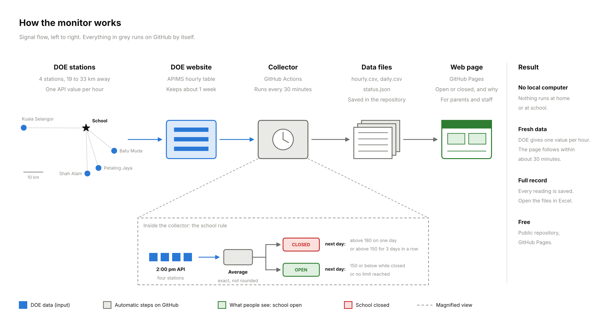

# Sasana Haze Monitor

This repository checks the air quality every hour. It works out the school closure
status from the school's Haze Protocol. It shows the result on a web page.

Everything runs on GitHub. No computer at home or at school is needed.

## What it does

- Once per hour, at minute 15, GitHub runs `scripts/collect.py`.
- The script reads the hourly API (Air Pollutant Index) from the DOE website.
- It keeps four stations: Batu Muda, Petaling Jaya, Shah Alam, Kuala Selangor.
- It saves the readings in `docs/data/hourly.csv`.
- It takes the 2:00 pm reading of each day and averages the four stations.
- It applies the school rule and writes `docs/data/daily.csv` and `docs/data/status.json`.
- GitHub Pages shows `docs/index.html`. The page reads `status.json`.

DOE publishes one reading per hour. So the data changes once per hour.
One run per hour is enough in most hours. Sometimes a station reading is late.
Then the run waits 15 minutes and starts one more run by itself. This happens one time only.
A reading that is still missing after that is collected by the run of the next hour.

## The forecast (section 6 of the page, for planning only)

- Twice a day, at about 7:30 am and 7:30 pm, GitHub runs `scripts/forecast.py`.
- It reads the CAMS haze model (Copernicus, run by ECMWF) through Open-Meteo: PM2.5 for the next 5 days.
- Three stations lie in one CAMS cell (KL), Kuala Selangor in another (KS). Two calls are enough.
- For each day it averages the 24 hours ending at 2:00 pm, like the DOE API.
- It multiplies by a calibration factor: observed PM2.5 (from the DOE API) divided by CAMS PM2.5,
  the median of the newest 10 haze days (API 100 or above), looking back up to 60 days.
  Older haze days are kept, so the factor is still right when haze comes back after a clean spell.
- It converts PM2.5 to API with the DOE formula and averages the four stations.
- It writes `docs/data/forecast.json`. Section 6 of the page shows the chart, wind and rain, and a table.
  The page `forecast.html` explains the method, with the current correction factors.
- Every run is also added to `docs/data/forecast_history.jsonl`, to check the forecast later.
- The forecast never feeds the rule. A failure of the forecast run never stops the hourly collection.

## The rule

- Average 180 or above on any single day: school is closed the next day.
- Average 150 or above for three days in a row: school is closed the next day.
- While school is closed: an average below 150 reopens school the next day.
- The count of three days restarts after school reopens.

## Set up (one time, about 10 minutes)

1. Create a new **public** repository on GitHub. GitHub Pages is free for public repositories.
2. Put all files of this folder in the repository, on the `main` branch.
   The folder `.github/workflows` must be included. It is a hidden folder on some computers.
3. Open **Settings → Pages**. Under "Build and deployment", set **Source** to **GitHub Actions**.
4. Open the **Actions** tab. If GitHub asks, allow workflows to run.
5. Choose **Collect air quality data → Run workflow**. Wait about one minute.
6. Open the page address shown in **Settings → Pages**.
   It looks like `https://YOUR-NAME.github.io/REPOSITORY-NAME/`.

After this, GitHub runs the collection by itself.

## Settings

All settings are in `config.json`.

| Setting | Meaning | Now |
|---|---|---|
| `reading_hour` | Hour of the daily reading, Malaysia time | 14 |
| `school_days` | Days with school. Other days show "No school". | Mon to Fri |
| `no_school_dates` | Extra days without school. An entry is a date, `"2026-12-25"`, or a date with a name, `{"date": "2026-10-26", "name": "Public holiday in Selangor"}` | 26 Oct 2026 |
| `close_from_single_day` | Close when the average is this or above on one day | 180 |
| `close_from_streak` | Count a day when the average is this or above | 150 |
| `streak_days` | Days in a row needed to close | 3 |
| `reopen_below` | Reopen when the average is below this | 150 |
| `min_stations` | Fewest stations needed for a usable average | 3 |
| `start_date` | First day the rule is applied. School is taken as open on this day. | 2026-10-09 |
| `table_first_date` | First day in the table "Daily API records". Older days stay in the data files and in the chart. | 2026-10-09 |
| `forecast.cells` | Latitude and longitude of the two CAMS cells. Each station has a `cell`. | KL 3.2, 101.6; KS 3.2, 101.2 |
| `forecast.forecast_days` | Days to forecast | 5 |
| `forecast.calibration_haze_days` | Newest haze days used for the calibration factor | 10 |
| `forecast.calibration_lookback_days` | How far back to look for those haze days | 60 |
| `forecast.calibration_clean_days` | Days used for the clean-day factor (information only) | 14 |
| `forecast.haze_day_api` | A day with observed API at or above this is a haze day | 100 |
| `forecast.min_calibration_days` | Fewest haze days needed. With fewer, all days of the last 14 are used. | 3 |
| `backfill_days` | How many past days the script tries to fill | 7 |
| `stale_after_hours` | The page shows a warning when the data is older than this | 3 |
| `late_after_hour` | From this hour, a missing 2:00 pm reading is shown as "did not arrive" | 15 |

To change a station, edit the `stations` list. The station `id` and `state_id` come from DOE.

## Open questions for the school

The notice does not say what to do in these cases. The code makes a choice. Each choice is easy to change.

1. **Weekends and holidays.** The page shows "No school" on these days.
   The rule still counts their readings. So the Sunday 2:00 pm reading decides Monday.
   A high weekend day also counts toward the three days in a row.
2. **A station does not report at 2:00 pm.** With 3 stations, the code averages the 3 and shows a yellow note.
   With 2 or fewer, there is no decision for that day.
3. **No reading for a whole day.** Status and count stay as they were. The page asks to check DOE.
4. **Rounding.** The average is rounded to a whole number before it is compared with the limits.
   0.5 and above goes up. So 149.5 becomes 150, and 141.4 becomes 141.
5. **Exactly 150 and exactly 180.** The notice says "above 150" and "above 180".
   The page counts 150 itself and 180 itself as high (owner's decision).
   So 149.5 becomes 150 and counts toward the three days. 179.5 becomes 180 and closes school the next day.
   While school is closed, 150 keeps it closed. Only an average below 150 reopens it.
6. **Start date.** Days before `start_date` are shown but not counted.

## If something goes wrong

- The page shows a yellow warning when the newest reading is more than 3 hours old.
- GitHub sends an email to the repository owner when a run fails.
- The DOE website keeps about one week of hourly data. After a break, the script fills the gap by itself, up to 7 days.
- GitHub stops scheduled runs after 60 days with no activity in a public repository.
  This repository saves data every hour, so this should not happen.

## Files

| File | Purpose |
|---|---|
| `config.json` | Stations, limits, times |
| `scripts/policy.py` | The rule. No network, no files. |
| `scripts/collect.py` | Reads DOE, saves data, builds the status |
| `scripts/forecast.py` | Reads CAMS through Open-Meteo, writes the forecast |
| `docs/index.html` | The web page |
| `docs/forecast.html` | How the forecast is made (linked from section 6). It reads `forecast.json` for the current correction factors. |
| `docs/data/` | The data: `hourly.csv`, `daily.csv`, `status.json`, `forecast.json`, `forecast_history.jsonl` |
| `.github/workflows/collect.yml` | The hourly collection |
| `.github/workflows/forecast.yml` | The forecast, twice a day |
| `tests/` | Tests. Run with `python3 -m unittest discover -s tests` |

## Data source

Department of Environment Malaysia (DOE), Air Pollutant Index Management System (APIMS):
<https://eqms.doe.gov.my/APIMS/main>

Forecast: contains modified Copernicus Atmosphere Monitoring Service information (CAMS, ECMWF),
and ECMWF open data for the weather, both through <https://open-meteo.com/> (free for non-commercial use).

The page is a calculation aid. The school's own announcement is the official decision.
